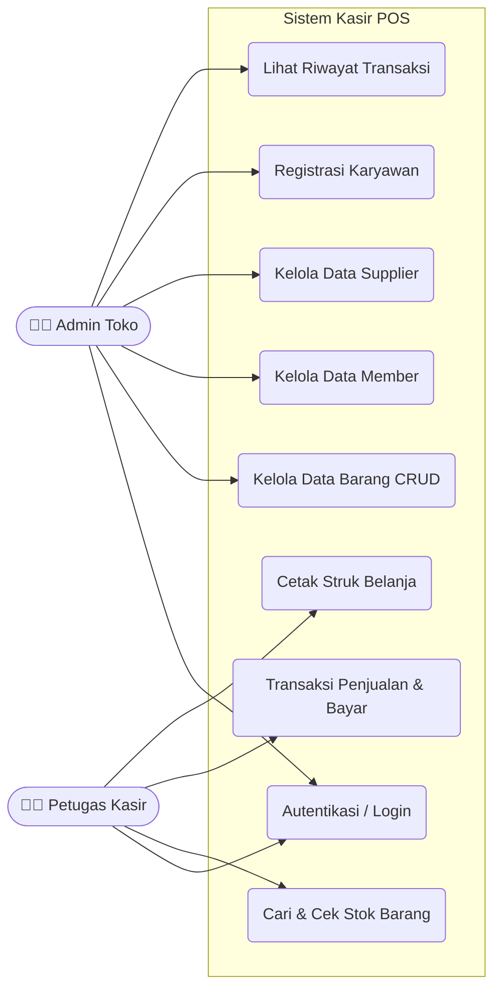
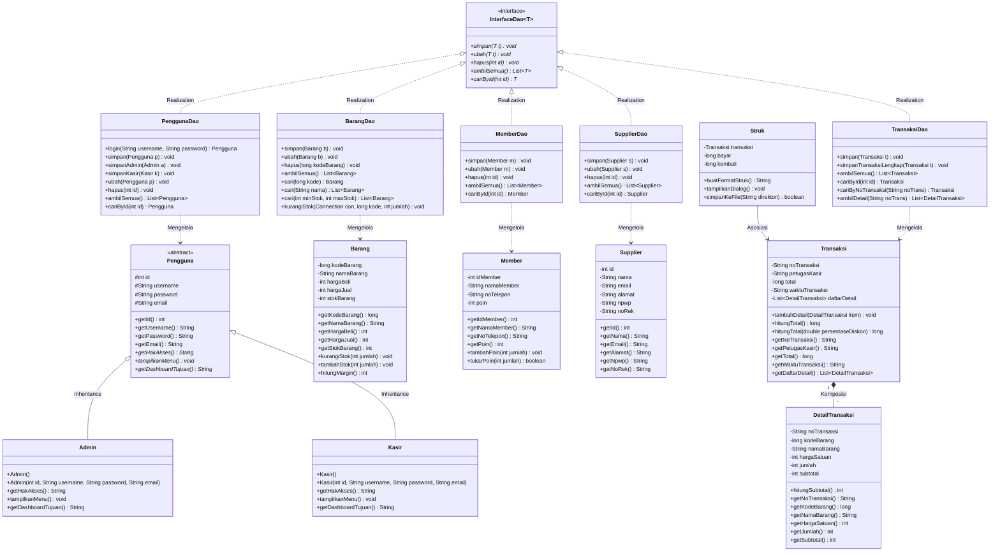
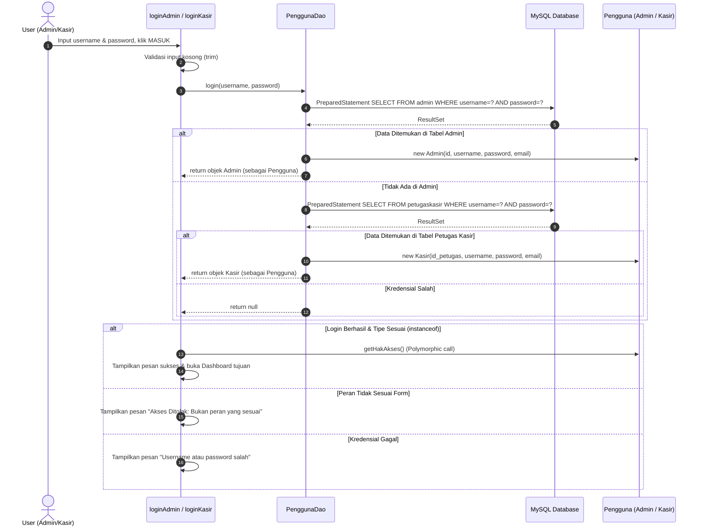
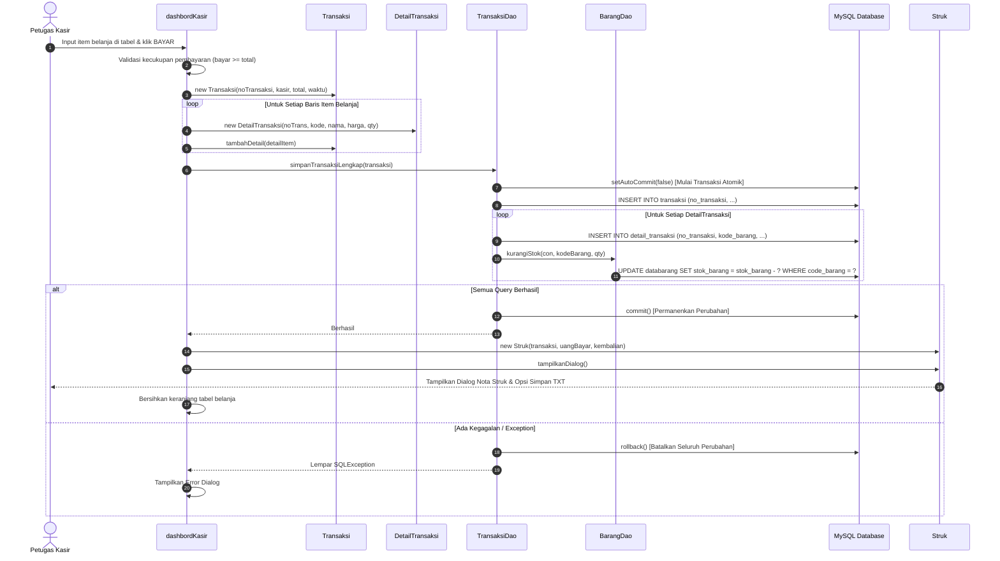

# 📑 DOKUMENTASI SISTEM POS KASIR (UNTUK LAPORAN TUGAS BESAR PBO)

Dokumentasi ini disusun berdasarkan **kode sumber final** yang telah diuji dan dikompilasi, bukan berdasarkan asumsi. Diagram digambarkan menggunakan format standard **Mermaid** sehingga dapat langsung dirender di Markdown viewer, GitHub, maupun diekspor ke laporan dokumen.

---

## 1. Use Case Diagram

Diagram ini memetakan interaksi antara dua aktor utama (**Admin** dan **Petugas Kasir**) dengan sistem POS Kasir.



---

## 2. Class Diagram

Class diagram ini mencerminkan struktur kelas yang sebenarnya di dalam package `main.model`, `main.dao`, dan interaksinya dengan komponen presentation `main`.



---

## 3. Sequence Diagram Alur Utama

### A. Sequence Diagram: Autentikasi Pengguna (Login Polimorfik)

Alur ini menunjukkan bagaimana class `loginAdmin` atau `loginKasir` berinteraksi dengan `PenggunaDao`, dan bagaimana polymorphism runtime digunakan untuk menentukan hak akses akun.



---

### B. Sequence Diagram: Transaksi Penjualan Atomik & Cetak Struk

Alur ini menggambarkan saat kasir menekan tombol **BAYAR** pada `dashbordKasir`, di mana transaksi database atomik dijalankan (`setAutoCommit(false)`), stok barang dikurangi, dan struk dicetak melalui class `Struk`.



---

## 4. Ringkasan Bab Aplikasi & Struktur Proyek

### A. Fitur-Fitur Utama Aplikasi
1. **Autentikasi Aman & Berbasis Peran (RBAC)**: Login terpisah untuk Admin dan Kasir dengan validasi objek polimorfik `Pengguna`.
2. **Kelola Produk (CRUD Barang)**: Form admin untuk menambah, mengubah, menghapus, dan memantau stok barang dengan validasi angka dan stok non-negatif.
3. **Pencarian Real-Time (List Barang)**: Form kasir untuk mencari barang berdasarkan kata kunci dengan filter dinamis.
4. **Transaksi Penjualan Atomik**: Perhitungan otomatis subtotal, total harga, dan kembalian. Menyimpan header dan rincian item transaksi secara atomik (semua sukses atau semua dibatalkan jika stok gagal).
5. **Manajemen Stok Otomatis**: Stok barang berkurang otomatis di database saat transaksi kasir berhasil dibayar.
6. **Pencetakan Struk (Nota Belanja)**: Class `Struk` menyusun format nota rapi dengan opsi tampilan dialog interaktif dan simpan berkas `.txt`.
7. **Laporan Riwayat Penjualan**: Form `riwayatTransaksi` untuk meninjau data penjualan masa lalu dan mengecek rincian per nota.
8. **Kelola Data Pelanggan (Member)**: Pencatatan identitas pelanggan dan akumulasi poin reward.
9. **Kelola Pemasok (Supplier)**: Manajemen kontak dan rekening supplier pemasok barang toko.

### B. Cara Menjalankan Aplikasi
1. Aktifkan **MySQL** di XAMPP Control Panel (port `3306`).
2. Pastikan database `kasir` telah terbuat dan skrip tambahan di [`schema_tambahan.sql`](file:///c:/Users/NITRO/Downloads/POS-KasirJAVA-PBO/schema_tambahan.sql) sudah dijalankan.
3. Buka PowerShell dan jalankan:
   ```powershell
   & "C:\Users\NITRO\.jdks\openjdk-26.0.2.1\bin\java.exe" -cp "build\classes;lib\*" main.MenuUtama
   ```
   *(Atau buka proyek di Apache NetBeans dan jalankan `MenuUtama.java`)*.

### C. Struktur Package Proyek
- `main` : Form antarmuka pengguna berbasis Java Swing JFrame (`MenuUtama`, `loginAdmin`, `loginKasir`, `dashbordAdmin`, `dashbordKasir`, `tambahBarang`, `listBarang`, `dataMember`, `dataSupplier`, `registrasi`, `riwayatTransaksi`).
- `main.model` : Kelas POJO entitas bisnis (`Barang`, `Member`, `Supplier`, `Transaksi`, `DetailTransaksi`, `Struk`), generic interface `InterfaceDao<T>`, serta kelas abstrak `Pengguna` dengan subkelas `Admin` dan `Kasir`.
- `main.dao` : Kelas Data Access Object berparameter `PreparedStatement` aman dari injeksi SQL (`BarangDao`, `MemberDao`, `SupplierDao`, `PenggunaDao`, `TransaksiDao`).
