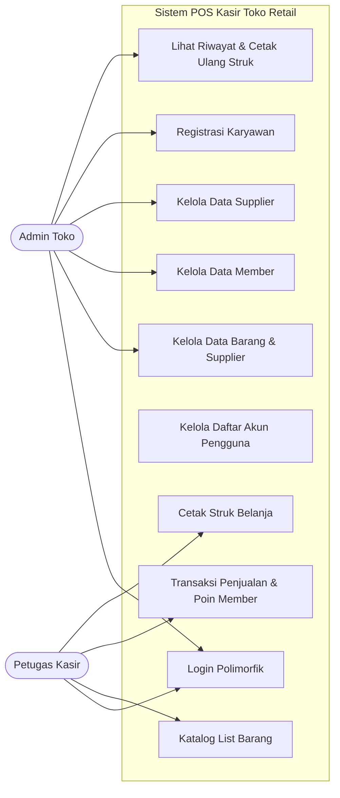
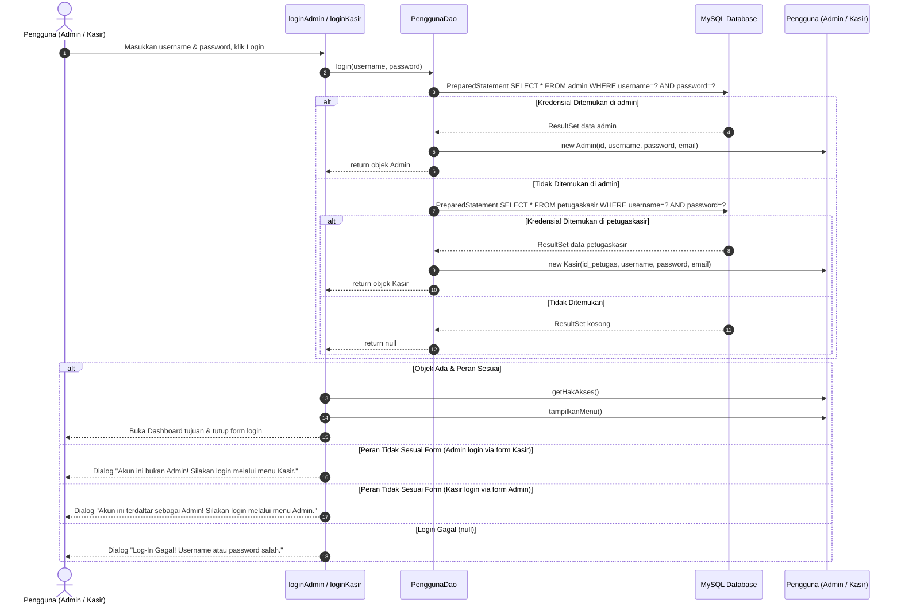
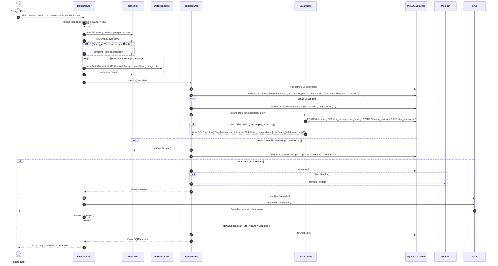
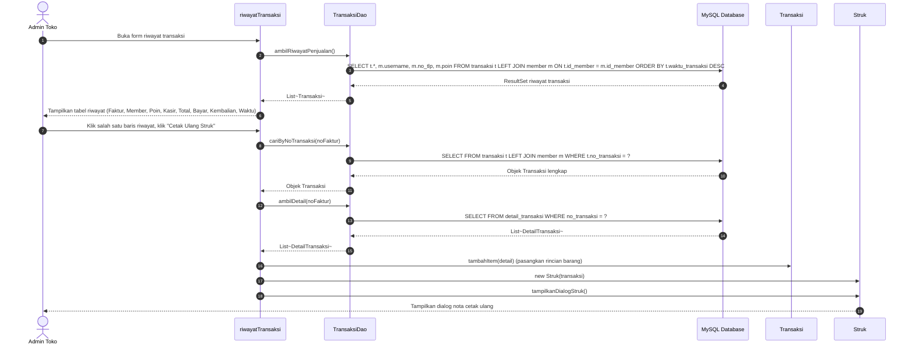
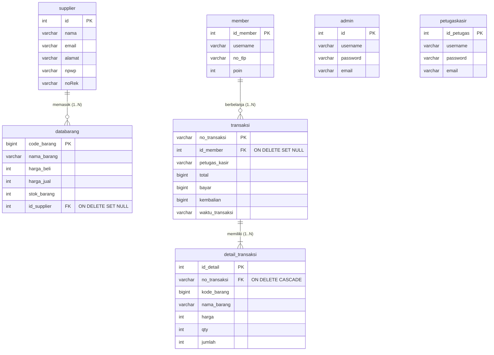

# 📑 LAPORAN TUGAS BESAR PEMROGRAMAN BERORIENTASI OBJEK
# SISTEM INFORMASI POINT OF SALE (POS) KASIR TOKO RETAIL

---

## A. PENDAHULUAN

### 1. Latar Belakang
Pada era digitalisasi retail modern, efisiensi dan akurasi proses transaksi penjualan di meja kasir menjadi faktor penentu keberhasilan operasional toko. Sistem pencatatan kasir berbasis manual atau aplikasi monolitik prosedural sering menghadapi kendala integritas data: kerentanan injeksi SQL akibat penggabungan string query secara langsung, ketidaksinkronan stok barang saat transaksi gagal di tengah jalan, serta sulitnya pengembangan fitur karena logika antarmuka dan basis data bercampur aduk.

Melalui tugas besar mata kuliah Pemrograman Berorientasi Objek (PBO), aplikasi kasir ini dikembangkan ulang (*refactoring*) dari basis kode sumber terbuka legacy. Arsitektur sistem ditransformasikan menjadi arsitektur berlapis (*layered architecture*) yang menerapkan 4 pilar fundamental OOP (Encapsulation, Inheritance, Abstraction, dan Polymorphism), pola *Data Access Object* (DAO), penjaminan transaksi basis data atomik (ACID), serta integrasi relasi data modern antara Supplier ke Barang dan Member ke Transaksi.

### 2. Rumusan Masalah
1. Bagaimana merancang arsitektur perangkat lunak kasir yang memisahkan tanggung jawab antarmuka (Presentation), logika bisnis (Domain Model), dan akses basis data (DAO)?
2. Bagaimana menerapkan empat pilar OOP (Encapsulation, Inheritance, Abstraction, Polymorphism) secara nyata dan tepat guna pada sistem kasir?
3. Bagaimana menjamin keamanan basis data dari ancaman *SQL Injection* menggunakan `PreparedStatement`?
4. Bagaimana mengimplementasikan transaksi penjualan yang atomik, di mana pemotongan stok barang, penambahan poin member, dan pencatatan faktur dieksekusi dalam satu siklus `commit` dan `rollback` yang konsisten?
5. Bagaimana mengelola relasi One-to-Many antara Supplier ke Barang dan Member ke Transaksi secara aman?

### 3. Tujuan
1. Menghasilkan sistem Point of Sale (POS) berbasis Java Swing desktop dan MySQL yang modular, aman, dan berorientasi objek murni.
2. Mengimplementasikan 4 pilar OOP: pembungkusan data bervalidasi (Encapsulation), pewarisan kelas akun (Inheritance), kontrak interface dan abstract class (Abstraction), serta *dynamic dispatch* dan *method overloading* (Polymorphism).
3. Mengeliminasi celah kerentanan *SQL Injection* melalui pemanfaatan `PreparedStatement` di seluruh lapisan DAO.
4. Menjamin integritas data transaksi penjualan melalui mekanisme transaksi basis data (ACID *Transaction Management*).
5. Menyediakan fitur terpadu: pengelolaan barang dan pemasok, program loyalitas pelanggan (member & poin reward), serta pelaporan riwayat penjualan dan cetak nota belanja.

### 4. Ruang Lingkup
- **Aplikasi**: Berbasis desktop Java Swing (JDK 8+ / OpenJDK 26).
- **Basis Data**: MySQL Server (port 3306) dengan koneksi JDBC terpusat.
- **Aktor Sistem**: Dua peran pengguna, yaitu **Administrator** (kelola master barang, supplier, member, registrasi karyawan, riwayat transaksi) dan **Kasir** (penjualan, cek katalog barang, pemilihan member, perolehan poin, cetak nota).
- **Batasan**: Aplikasi beroperasi pada jaringan lokal (*single-store desktop*), kata sandi akun disimpan dalam basis data, dan pencetakan nota disajikan melalui dialog pratinjau serta ekspor berkas teks fisik (`.txt`).

### 5. Manfaat Aplikasi
- **Bagi Pengelola Toko (Admin)**: Mempermudah pemantauan stok produk secara realtime, menjaga riwayat pemasok barang (Supplier), dan menganalisis histori penjualan dengan aman.
- **Bagi Petugas Kasir**: Mempercepat proses checkout transaksi penjualan, meminimalisasi salah hitung kembalian, dan memberikan struk belanja langsung kepada pelanggan.
- **Bagi Pelanggan (Member)**: Meningkatkan loyalitas melalui perolehan poin belanja yang tercatat otomatis pada struk dan basis data.
- **Bagi Akademisi / Pengembang**: Memberikan studi kasus nyata transformasi arsitektur legacy monolitik menuju kode berorientasi objek yang terstruktur dan memenuhi standar rancangan perangkat lunak.

---

## B. OBJECT-ORIENTED ANALYSIS (OOA)

### 1. Use Case Diagram

Diagram Use Case memetakan fungsionalitas sistem yang dapat diakses oleh aktor **Admin** dan **Kasir**:

### Tabel Deskripsi Use Case
| ID | Nama Use Case | Aktor | Deskripsi Singkat |
| :--- | :--- | :--- | :--- |
| **UC1** | Login Polimorfik | Admin, Kasir | Mengautentikasi pengguna menggunakan `PenggunaDao.login`, memeriksa tabel `admin` dan `petugaskasir`, lalu mengarahkan ke dashboard yang sesuai secara polimorfik. |
| **UC2** | Kelola Data Barang & Supplier | Admin | Operasi CRUD data barang pada `tambahBarang`, memantau stok, serta memilih supplier pemasok dari combo box (relasi One-to-Many). |
| **UC3** | Kelola Data Member | Admin | Operasi CRUD data member pelanggan pada `dataMember`, mencatat nomor telepon dan memantau akumulasi poin reward. |
| **UC4** | Kelola Data Supplier | Admin | Operasi CRUD data vendor pemasok pada `dataSupplier` dengan validasi konfirmasi dependensi sebelum penghapusan. |
| **UC5** | Registrasi Karyawan | Admin | Mendaftarkan akun admin atau kasir baru pada form `registrasi` menggunakan method polimorfik `PenggunaDao.simpan`. |
| **UC5b** | Kelola Daftar Akun Pengguna | Admin | Menampilkan daftar seluruh akun admin dan kasir tanpa password pada form `dataPengguna`, dengan proteksi cegah hapus akun sendiri. |
| **UC6** | Lihat Riwayat & Cetak Ulang Struk | Admin | Meninjau rekaman penjualan pada `riwayatTransaksi`, melihat rincian item barang per nota, serta mencetak ulang struk fisik. |
| **UC7** | Katalog List Barang | Kasir | Menelusuri katalog barang pada form `listBarang` secara realtime berdasarkan nama barang beserta nama supplier pemasoknya. |
| **UC8** | Transaksi Penjualan & Poin Member | Kasir | Memproses item belanjaan pada `dashbordKasir`, memilih pelanggan member, kalkulasi otomatis subtotal dan kembalian, serta penambahan poin member. |
| **UC9** | Cetak Struk Belanja | Kasir | Menyajikan pratinjau nota belanja rapi monospaced via class `Struk` dan menyediakan fitur simpan ke berkas fisik `.txt`. |

---

### 2. Class Diagram

Class diagram berikut mencakup seluruh kelas di package `main.model` dan `main.dao`, atribut dan method utama, serta hubungan relasi objek yang ada di kode sumber:

```mermaid
classDiagram
    %% Kontrak Abstraksi
    class InterfaceDao~T~ {
        <<interface>>
        +simpan(T entitas)* void
        +ubah(T entitas)* void
        +hapus(int id)* void
        +ambilSemua()* List~T~
        +cariById(int id)* T
    }

    class Pengguna {
        <<abstract>>
        #int id
        #String username
        #String password
        #String email
        +getId() int
        +getUsername() String
        +getPassword() String
        +getEmail() String
        +getHakAkses()* String
        +tampilkanMenu()* String[]
        +getDashboardTujuan()* String
    }

    class Admin {
        +Admin()
        +Admin(int id, String username, String password, String email)
        +getHakAkses() String
        +tampilkanMenu() String[]
        +getDashboardTujuan() String
    }

    class Kasir {
        +Kasir()
        +Kasir(int id, String username, String password, String email)
        +getHakAkses() String
        +tampilkanMenu() String[]
        +getDashboardTujuan() String
    }

    Pengguna <|-- Admin : Inheritance
    Pengguna <|-- Kasir : Inheritance

    %% Domain Model
    class Supplier {
        -int id
        -String nama
        -String email
        -String alamat
        -String npwp
        -String noRek
        +getId() int
        +getNama() String
        +getEmail() String
        +getAlamat() String
        +getNpwp() String
        +getNoRek() String
        +setId(int id) void
        +setNama(String nama) void
        +setEmail(String email) void
        +setAlamat(String alamat) void
        +setNpwp(String npwp) void
        +setNoRek(String noRek) void
    }

    class Barang {
        -long kodeBarang
        -String namaBarang
        -int hargaBeli
        -int hargaJual
        -int stokBarang
        -Supplier supplier
        +getKodeBarang() long
        +getNamaBarang() String
        +getHargaBeli() int
        +getHargaJual() int
        +getStokBarang() int
        +getSupplier() Supplier
        +setSupplier(Supplier supplier) void
        +setKodeBarang(long kodeBarang) void
        +setNamaBarang(String namaBarang) void
        +setHargaBeli(int hargaBeli) void
        +setHargaJual(int hargaJual) void
        +setStokBarang(int stokBarang) void
        +hitungMargin() int
        +kurangiStok(int jumlah) void
        +tambahStok(int jumlah) void
        +tersedia() boolean
    }

    class Member {
        -int idMember
        -String namaMember
        -String noTelepon
        -int poin
        +getIdMember() int
        +getNamaMember() String
        +getNoTelepon() String
        +getPoin() int
        +setIdMember(int idMember) void
        +setNamaMember(String namaMember) void
        +setNoTelepon(String noTelepon) void
        +setPoin(int poin) void
        +tambahPoin(int totalBelanja) void
        +tambahPoin(long totalBelanja) void
        +tukarPoin(int jumlahPoin) int
    }

    class DetailTransaksi {
        -int idDetail
        -String noTransaksi
        -long kodeBarang
        -String namaBarang
        -int harga
        -int qty
        -int jumlah
        +getIdDetail() int
        +getNoTransaksi() String
        +getKodeBarang() long
        +getNamaBarang() String
        +getHarga() int
        +getQty() int
        +getJumlah() int
        +setIdDetail(int idDetail) void
        +setNoTransaksi(String noTransaksi) void
        +setKodeBarang(long kodeBarang) void
        +setNamaBarang(String namaBarang) void
        +setHarga(int harga) void
        +setQty(int qty) void
        +hitungJumlah() int
    }

    class Transaksi {
        -String noTransaksi
        -String petugasKasir
        -String waktuTransaksi
        -long total
        -long jumlahBayar
        -long kembalian
        -int diskon
        -List~DetailTransaksi~ listDetail
        -Member member
        +getNoTransaksi() String
        +getPetugasKasir() String
        +getWaktuTransaksi() String
        +getTotal() long
        +getJumlahBayar() long
        +getKembalian() long
        +getDiskon() int
        +getListDetail() List~DetailTransaksi~
        +getMember() Member
        +setMember(Member member) void
        +getPoinDidapat() int
        +setNoTransaksi(String noTransaksi) void
        +setPetugasKasir(String petugasKasir) void
        +setWaktuTransaksi(String waktuTransaksi) void
        +setDiskon(int diskon) void
        +setTotal(long total) void
        +setKembalian(long kembalian) void
        +setJumlahBayar(long jumlahBayar) void
        +tambahItem(DetailTransaksi detail) void
        +hapusItem(int indeks) void
        +hitungTotal() long
        +hitungKembalian(long bayar) long
        +sudahAdaItem() boolean
    }

    class Struk {
        -Transaksi transaksi
        -NumberFormat formatRupiah
        +buatTeksStruk() String
        +tampilkanDialogStruk() void
        +simpanKeFile(String isiStruk) void
    }

    %% Relasi Model
    Supplier "1" -- "*" Barang : Memasok
    Member "1" -- "*" Transaksi : Berbelanja
    Transaksi "1" *-- "*" DetailTransaksi : Komposisi
    Struk --> Transaksi : Asosiasi

    %% DAO Layer
    class BarangDao {
        +simpan(Barang entitas) void
        +ubah(Barang entitas) void
        +hapus(int id) void
        +hapus(long kodeBarang) void
        +ambilSemua() List~Barang~
        +cariById(int id) Barang
        +cari(long kodeBarang) Barang
        +cari(String namaBarang) List~Barang~
        +cari(int minStok, int maxStok) List~Barang~
        +hitungBarangBySupplier(int idSupplier) int
        +kurangiStok(Connection con, long kodeBarang, int jumlah) void
    }

    class PenggunaDao {
        +login(String username, String password) Pengguna
        +simpan(Pengguna entitas) void
        +simpanAdmin(Admin admin) void
        +simpanKasir(Kasir kasir) void
        +ubah(Pengguna entitas) void
        +hapus(int id) void
        +ambilSemua() List~Pengguna~
        +cariById(int id) Pengguna
    }

    class MemberDao {
        +simpan(Member entitas) void
        +ubah(Member entitas) void
        +hapus(int idMember) void
        +ambilSemua() List~Member~
        +cariById(int idMember) Member
    }

    class SupplierDao {
        +simpan(Supplier entitas) void
        +ubah(Supplier entitas) void
        +hapus(int idSupplier) void
        +ambilSemua() List~Supplier~
        +cariById(int idSupplier) Supplier
    }

    class TransaksiDao {
        +simpan(Transaksi tr) void
        +ubah(Transaksi entitas) void
        +hapus(int id) void
        +hapusByNoTransaksi(String noTransaksi) void
        +ambilSemua() List~Transaksi~
        +cariById(int id) Transaksi
        +ambilRiwayatPenjualan() List~Transaksi~
        +cariByNoTransaksi(String noTransaksi) Transaksi
        +ambilNoTransaksiTerakhir() String
        +ambilDetail(String noTransaksi) List~DetailTransaksi~
    }

    class koneksi {
        <<utility>>
        +Connection con
        +Statement stm
        +username$ String
        +buka()$ Connection
        +config() void
    }

    InterfaceDao~Barang~ <|.. BarangDao : Realisasi
    InterfaceDao~Pengguna~ <|.. PenggunaDao : Realisasi
    InterfaceDao~Member~ <|.. MemberDao : Realisasi
    InterfaceDao~Supplier~ <|.. SupplierDao : Realisasi
    InterfaceDao~Transaksi~ <|.. TransaksiDao : Realisasi

    BarangDao ..> koneksi : Membuka DB via buka
    PenggunaDao ..> koneksi : Membuka DB via buka
    MemberDao ..> koneksi : Membuka DB via buka
    SupplierDao ..> koneksi : Membuka DB via buka
    TransaksiDao ..> koneksi : Membuka DB via buka

    BarangDao ..> Barang : Mengelola
    PenggunaDao ..> Pengguna : Mengelola
    MemberDao ..> Member : Mengelola
    SupplierDao ..> Supplier : Mengelola
    TransaksiDao ..> Transaksi : Mengelola
    TransaksiDao ..> BarangDao : kurangiStok
```

---

## C. OBJECT-ORIENTED DESIGN (OOD)

### 1. Sequence Diagram

Berikut adalah tiga alur kerja utama sistem yang menggunakan nama kelas dan method sesuai kode program:

#### Alur 1: Autentikasi Pengguna (Login Polimorfik)

#### Alur 2: Transaksi Penjualan Atomik, Pemotongan Stok, dan Poin Member

#### Alur 3: Riwayat Penjualan dan Cetak Ulang Struk

---

### 2. Rancangan Basis Data (ERD)

Struktur tabel fisik pada basis data `kasir` beserta relasi foreign key:

#### Aturan Integritas Kunci Asing (Foreign Key Constraints):
1. **`fk_barang_supplier`**: `databarang.id_supplier` merujuk ke `supplier.id` dengan aksi `ON DELETE SET NULL ON UPDATE CASCADE`. Jika data supplier dihapus, barang tetap tersimpan di toko dengan status tanpa supplier (`NULL`).
2. **`fk_transaksi_member`**: `transaksi.id_member` merujuk ke `member.id_member` dengan aksi `ON DELETE SET NULL ON UPDATE CASCADE`. Jika akun member dihapus, riwayat keuangan transaksi toko tidak hilang.
3. **`no_transaksi`**: Menghubungkan header transaksi pada tabel `transaksi` dengan rincian barang di tabel `detail_transaksi`.

---

## D. OBJECT-ORIENTED PROGRAMMING (IMPLEMENTASI APLIKASI)

### 1. Struktur Package dan Tanggung Jawab Kelas

Aplikasi diorganisasikan ke dalam tiga package utama:

#### Package `main` (Presentation Layer / Java Swing GUI)
- **`MenuUtama`**: Jendela pintu masuk awal aplikasi untuk memilih login sebagai Administrator atau Kasir.
- **`loginAdmin`**: Form autentikasi kredensial administrator menggunakan `PenggunaDao.login`.
- **`loginKasir`**: Form autentikasi kredensial petugas kasir menggunakan `PenggunaDao.login`.
- **`dashbordAdmin`**: Dashboard navigasi menu utama administrator toko.
- **`dashbordKasir`**: Dashboard transaksi kasir, pemilihan member, kalkulasi kembalian, dan pemrosesan penjualan.
- **`tambahBarang`**: Form manajemen master data produk barang (CRUD) dan pengaitan supplier pemasok.
- **`listBarang`**: Katalog penelusuran barang secara realtime untuk kasir dengan tampilan nama supplier.
- **`dataMember`**: Form manajemen data pelanggan member (CRUD) dan pemantauan perolehan poin.
- **`dataSupplier`**: Form manajemen data vendor pemasok (CRUD) dengan proteksi dependensi barang.
- **`dataPengguna`**: Form tampilan tabel seluruh akun pengguna (Admin dan Kasir) tanpa mengekspos password, dilengkapi validasi pencegahan admin menghapus akunnya sendiri yang sedang aktif digunakan.
- **`registrasi`**: Form pendaftaran akun kasir atau admin baru secara polimorfik.
- **`riwayatTransaksi`**: Form pemantauan riwayat penjualan, rincian item, dan cetak ulang struk.
- **`koneksi`**: Pengelola koneksi basis data terpusat melalui method statis `koneksi.buka()`.

#### Package `main.model` (Domain Model & Kontrak Abstraksi)
- **`InterfaceDao<T>`**: Generic interface yang mendefinisikan kontrak baku operasi persistensi data CRUD.
- **`Pengguna`**: Abstract class yang memodelkan atribut dasar akun dan mendeklarasikan method abstrak hak akses.
- **`Admin`**: Subclass konkret turunan `Pengguna` yang mengimplementasikan hak akses administrator.
- **`Kasir`**: Subclass konkret turunan `Pengguna` yang mengimplementasikan hak akses petugas kasir.
- **`Supplier`**: Model entitas pemasok barang toko (Encapsulation).
- **`Barang`**: Model entitas produk toko, asosiasi ke `Supplier`, dan aturan mutasi stok (Encapsulation).
- **`Member`**: Model entitas pelanggan loyalitas dan aturan bisnis perolehan poin reward (Encapsulation).
- **`DetailTransaksi`**: Model baris rincian item barang yang dibeli (Encapsulation).
- **`Transaksi`**: Model header transaksi penjualan, komposisi terhadap `DetailTransaksi`, dan asosiasi ke `Member`.
- **`Struk`**: Utilitas domain untuk memformat nota belanja monospaced, dialog pratinjau, dan ekspor berkas `.txt`.

#### Package `main.dao` (Data Access Object / Persistence Layer)
- **`BarangDao`**: Pengelola tabel `databarang` menggunakan PreparedStatement dan Method Overloading `cari`.
- **`MemberDao`**: Pengelola tabel `member` menggunakan PreparedStatement.
- **`SupplierDao`**: Pengelola tabel `supplier` menggunakan PreparedStatement.
- **`PenggunaDao`**: Pengelola tabel `admin` dan `petugaskasir` untuk login dan registrasi polimorfik.
- **`TransaksiDao`**: Pengelola transaksi penjualan atomik ACID (header, detail, stok, poin member).

---

### 2. Penerapan 4 Pilar OOP

#### a. Encapsulation (Pembungkusan Data)
- **File & Class**:
  - `src/main/model/Barang.java` (Class `Barang`)
  - `src/main/model/Member.java` (Class `Member`)
  - `src/main/model/Transaksi.java` (Class `Transaksi`)
  - `src/main/model/DetailTransaksi.java` (Class `DetailTransaksi`)
- **Method & Alasan**:
  Seluruh atribut dideklarasikan dengan access modifier `private`. Nilai atribut hanya dapat diakses melalui *getter* dan dimutasi melalui *setter* yang memiliki logika validasi.
  - Pada `Barang.setHargaJual(int)` dan `setStokBarang(int)`: melempar `IllegalArgumentException` jika nilai masukan bernilai negatif. Method bisnis `kurangiStok(int)` memastikan stok tidak bisa dikurangi melebihi sisa unit yang tersedia.
  - Pada `Member.tambahPoin(long totalBelanja)`: penambahan poin loyalitas dibungkus melalui formula bisnis (1 poin per Rp 10.000) sehingga saldo poin tidak dapat dimanipulasi sembarangan dari luar.
  - Pada `DetailTransaksi.hitungJumlah()`: nilai atribut `jumlah` (subtotal) dihitung secara otomatis dari perkalian `harga * qty` setiap kali harga atau kuantitas diubah.
  - Pada `Transaksi.hitungTotal()` dan `hitungKembalian(long bayar)`: total belanja diakumulasikan otomatis dari seluruh item dan nilai kembalian dikalkulasikan secara konsisten.

#### b. Inheritance (Pewarisan)
- **File & Class**:
  - `src/main/model/Pengguna.java` (Superclass)
  - `src/main/model/Admin.java` (Subclass: `public class Admin extends Pengguna`)
  - `src/main/model/Kasir.java` (Subclass: `public class Kasir extends Pengguna`)
- **Method & Alasan**:
  Atribut umum pengguna (`id`, `username`, `password`, `email`) dideklarasikan satu kali pada superclass `Pengguna`. Subclass `Admin` dan `Kasir` memanggil konstruktor induk via `super(id, username, password, email)`. Pewarisan ini mengeliminasi duplikasi kode antar tipe akun dan memungkinkan penambahan peran baru tanpa merombak struktur akun yang ada.

#### c. Abstraction (Abstraksi)
- **File & Class**:
  - `src/main/model/InterfaceDao.java` (Interface `InterfaceDao<T>`)
  - `src/main/model/Pengguna.java` (Abstract Class `Pengguna`)
- **Method & Alasan**:
  - `InterfaceDao<T>` menyediakan cetak biru baku metode CRUD (`simpan`, `ubah`, `hapus`, `ambilSemua`, `cariById`) menggunakan Java Generic `<T>`. Kelas DAO mengimplementasikan kontrak ini tanpa mengikat antarmuka GUI pada implementasi basis data tertentu.
  - `Pengguna` adalah kelas abstrak yang tidak dapat diinstansiasi secara langsung. Mendeklarasikan method abstrak:
    - `public abstract String getHakAkses();`
    - `public abstract String[] tampilkanMenu();`
    - `public abstract String getDashboardTujuan();`
    Setiap turunan diwajibkan mendefinisikan perilaku konkret sesuai hak aksesnya masing-masing.

#### d. Polymorphism (Polimorfisme)
- **1. Polimorfisme Dinamis (Method Overriding & Dynamic Dispatch)**:
  - **File**: `Admin.java`, `Kasir.java`, `PenggunaDao.java`, `loginAdmin.java`, `loginKasir.java`
  - **Penerapan**: Class `Admin` dan `Kasir` meng-override method `getHakAkses()`, `tampilkanMenu()`, dan `getDashboardTujuan()`. Method `PenggunaDao.login(username, password)` mengembalikan tipe referensi induk `Pengguna`. Saat runtime di form login, pemanggilan `pengguna.getHakAkses()` secara dinamis mengeksekusi implementasi milik kelas turunan yang sebenarnya (*runtime polymorphism*).
- **2. Polimorfisme Statis (Method Overloading)**:
  - **File**: `BarangDao.java` dan `Member.java`
  - **Penerapan**:
    - Pada `BarangDao`:
      - `public Barang cari(long kodeBarang)` : mencari satu barang berdasarkan barcode unik.
      - `public List<Barang> cari(String namaBarang)` : mencari daftar barang berdasarkan kemiripan nama (`LIKE ?`).
      - `public List<Barang> cari(int minStok, int maxStok)` : mencari daftar barang berdasarkan batas stok kritis.
      - `public void hapus(int id)` dan `public void hapus(long kodeBarang)`.
    - Pada `Member`:
      - `public void tambahPoin(int totalBelanja)` dan `public void tambahPoin(long totalBelanja)`.
    Seluruh method di atas memiliki nama yang sama tetapi dibedakan oleh tipe atau jumlah parameternya (*compile-time polymorphism*).

---

### 3. Ruang Tangkapan Layar Antarmuka Aplikasi

[TEMPEL SCREENSHOT: Form Login]

[TEMPEL SCREENSHOT: Dashboard Admin]

[TEMPEL SCREENSHOT: Form Tambah Barang (dengan Supplier)]

[TEMPEL SCREENSHOT: Form Data Supplier]

[TEMPEL SCREENSHOT: Form Data Member]

[TEMPEL SCREENSHOT: Form Kasir (dengan Member)]

[TEMPEL SCREENSHOT: Dialog Struk Pembayaran]

[TEMPEL SCREENSHOT: Form Riwayat Transaksi]

---

### 4. Penanganan Keamanan dan Transaksi Basis Data

#### a. Pencegahan SQL Injection dengan `PreparedStatement`
Seluruh query basis data di package `main.dao` telah dibersihkan dari konkatenasi string langsung. Semua parameter pengguna dipetakan menggunakan placeholder tanda tanya (`?`) melalui `PreparedStatement`. Dengan mekanisme ini, nilai input pengguna dikirim terpisah dari instruksi SQL sehingga masukan berbahaya diperlakukan murni sebagai nilai data literal dan tidak dapat mengubah struktur sintaks query.

#### b. Transaksi Basis Data Atomik (ACID)
Pada method `TransaksiDao.simpan(Transaksi tr)`, integritas data dijamin melalui transaksi atomik:
1. Mode autocommit dinonaktifkan: `con.setAutoCommit(false)`.
2. Header transaksi disimpan ke tabel `transaksi`.
3. Seluruh baris rincian disimpan ke tabel `detail_transaksi`.
4. Stok barang dikurangi via `BarangDao.kurangiStok(con, kodeBarang, qty)`. Jika stok di basis data tidak mencukupi, query update mengembalikan 0 baris terpengaruh dan memicu pelemparan `SQLException`.
5. Poin loyalitas member diperbarui pada tabel `member`.
6. Jika seluruh tahapan di atas berhasil, perubahan dipermanenkan via `con.commit()`.
7. Jika terjadi exception di salah satu tahapan, blok `catch` segera mengeksekusi `con.rollback()`, sehingga header, rincian barang, pemotongan stok, dan poin member seluruhnya dibatalkan secara utuh.

---

## E. PENUTUP

### 1. Kesimpulan
1. Sistem Informasi POS Kasir Toko Retail berhasil dirancang ulang menjadi arsitektur berlapis tiga (*layered architecture*) yang memisahkan tampilan GUI (`main`), logika bisnis domain (`main.model`), dan persistensi basis data (`main.dao`).
2. Penerapan empat pilar OOP (Encapsulation, Inheritance, Abstraction, Polymorphism) berhasil diwujudkan secara konkret pada model entitas dan kelas DAO, meningkatkan modularitas dan keterbacaan kode secara signifikan.
3. Keamanan basis data terlindungi sepenuhnya dari celah *SQL Injection* melalui pemanfaatan `PreparedStatement` berparameter di seluruh DAO.
4. Mekanisme transaksi basis data atomik (`commit` dan `rollback`) pada `TransaksiDao` berhasil menjamin konsistensi multi-tabel antara faktur penjualan, rincian item, saldo stok barang, dan poin loyalitas member.
5. Fitur relasi modern berhasil diintegrasikan dengan mulus: keterkaitan Supplier ke Barang via kunci asing aman (`ON DELETE SET NULL`), pemilihan Member kasir, perhitungan poin belanja otomatis, riwayat transaksi persisten, dan pencetakan nota fisik.

### 2. Keterbatasan Sistem
1. **Keamanan Kredensial**: Kata sandi akun admin dan kasir masih tersimpan dalam format teks polos (*plaintext*) pada basis data.
2. **Ketiadaan Pengujian Otomatis**: Proyek belum dilengkapi dengan berkas *unit testing* otomatis (seperti JUnit).
3. **Status Sesi Login**: Pelacakan identitas pengguna yang sedang masuk masih mengandalkan variabel statis `koneksi.username`.
4. **Kalkulasi Poin pada Riwayat**: Pada tampilan riwayat penjualan lama, nilai poin didapat dihitung ulang secara dinamis berdasarkan formula total belanja (`total / 10000`).

### 3. Saran Pengembangan
1. **Pengamanan Kata Sandi**: Menerapkan algoritma *cryptographic hashing* modern bergaram seperti **BCrypt** atau **Argon2** pada `PenggunaDao` sebelum kata sandi disimpan ke basis data.
2. **Laporan Penjualan Berdasarkan Periode**: Menambahkan filter rentang tanggal (harian, mingguan, bulanan) dan visualisasi grafik omzet penjualan pada dashboard admin.
3. **Penyempurnaan Sesi Pengguna**: Mengganti variabel statis dengan objek sesi *User Session Context* yang mengisolasi state pengguna yang sedang aktif secara aman.
4. **Penggunaan Connection Pool**: Mengintegrasikan pustaka *connection pooling* seperti **HikariCP** untuk mengoptimalkan efisiensi koneksi JDBC pada terminal kasir skala besar.

---

## F. DAFTAR PUSTAKA DAN ATRIBUSI

### 1. Daftar Pustaka
1. Deitel, P., & Deitel, H. (2018). *Java: How to Program (Early Objects)*, 11th Edition. Pearson Education.
2. Gamma, E., Helm, R., Johnson, R., & Vlissides, J. (1994). *Design Patterns: Elements of Reusable Object-Oriented Software*. Addison-Wesley.
3. Oracle Corporation. (2024). *Java Platform, Standard Edition Documentation (JDK Specification)*. Oracle Help Center.
4. MySQL AB. (2024). *MySQL 8.0 Reference Manual: Transactional and Locking Statements*. Oracle Corporation.

### 2. Atribusi Proyek Asal
Proyek ini dikembangkan dari basis kode sumber terbuka:
- **Repositori Asal**: [https://github.com/rahmattulus/POS-KasirJAVA](https://github.com/rahmattulus/POS-KasirJAVA)
- **Penulis Asli**: Rahmat Tulus

### 3. Daftar Bagian yang Ditambahkan dan Dimodifikasi
Seluruh penambahan dan modifikasi kode pada repositori ini ditandai secara konsisten menggunakan komentar `// [TAMBAHAN]`:
1. **Paket `main.model`**: Pembuatan generic interface `InterfaceDao<T>`, abstract class `Pengguna`, kelas konkret `Admin`, `Kasir`, `Supplier`, `Barang`, `Member`, `DetailTransaksi`, `Transaksi`, dan utilitas cetak `Struk`.
2. **Paket `main.dao`**: Pembuatan seluruh kelas Data Access Object (`BarangDao`, `MemberDao`, `SupplierDao`, `PenggunaDao`, `TransaksiDao`) dengan implementasi `PreparedStatement` penuh.
3. **Koneksi Terpusat**: Penambahan method statis `koneksi.buka()` pada `main.koneksi` yang dipakai oleh seluruh DAO.
4. **Integritas Relasi Basis Data**:
   - Pembuatan tabel `detail_transaksi` pada `schema_tambahan.sql`.
   - Penambahan kolom `bayar` dan `kembalian` pada tabel `transaksi`.
   - Penambahan relasi One-to-Many `id_supplier` pada `databarang` (FK ke `supplier.id` ON DELETE SET NULL).
   - Penambahan relasi One-to-Many `id_member` pada `transaksi` (FK ke `member.id_member` ON DELETE SET NULL).
5. **Pembaruan Form GUI (Tanpa Mengubah Blok Auto-Generated NetBeans)**:
   - Form `MenuUtama`, `loginAdmin`, dan `loginKasir` disambungkan ke `PenggunaDao.login` secara polimorfik.
   - Form `tambahBarang` ditambahkan combo box pemilihan supplier dan kolom supplier pada tabel.
   - Form `listBarang` menampilkan nama supplier pemasok.
   - Form `dataSupplier` dilengkapi dialog validasi peringatan dependensi barang sebelum menghapus supplier.
   - Form `dataMember` disambungkan ke `MemberDao`.
   - Form `registrasi` disambungkan ke `PenggunaDao.simpan` polimorfik.
   - Form `dashbordKasir` ditambahkan combo box pemilihan member, kalkulasi poin loyalitas, serta pemrosesan transaksi atomik ACID.
   - Form `riwayatTransaksi` dibuat baru untuk menampilkan histori transaksi, rincian item barang, serta pencetakan ulang nota belanja.
